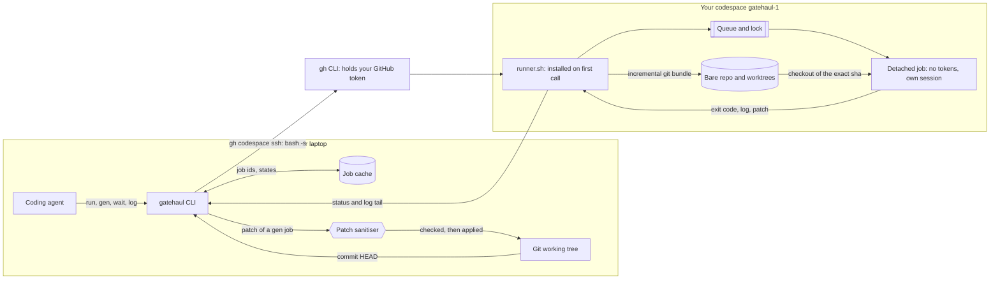
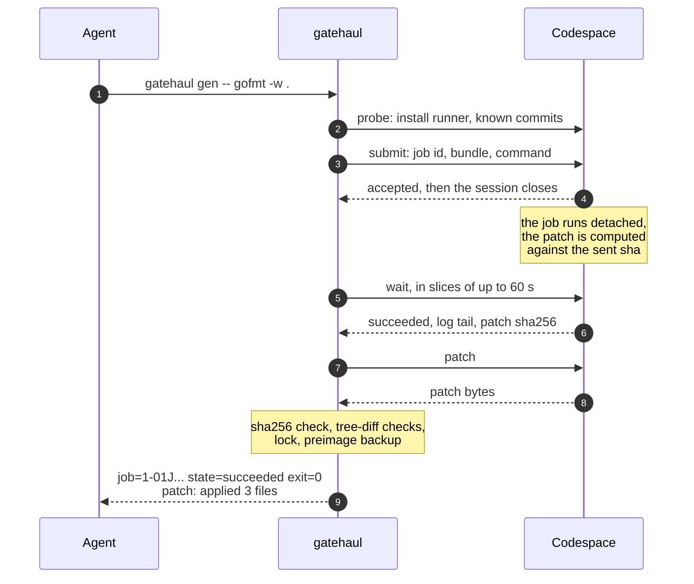

# gatehaul

[](https://github.com/camilbenameur/gatehaul/actions/workflows/ci.yml)
[](LICENSE)
[](go.mod)

**Offload your coding agents' builds and tests to your own GitHub Codespaces, and get proof they actually ran.**

Agents such as Claude Code or Codex run builds and test suites hundreds of times a day. On a laptop this is slow and noisy. Remote, three things go wrong: an agent cannot block for 20 minutes on a test run, a "green" that ran zero tests or tested a stale commit slips through, and the sandbox that runs agent-written code should not hold your credentials. gatehaul is a single Go binary on top of [`gh`](https://cli.github.com/) that handles all three, with zero configuration.

> **Status: early development.** `doctor`, `up`, `down`, `run`, `wait`, `log`, `gen` and `apply` work today, on one codespace. Gates with proof of execution and scheduling over several codespaces are next. The technical specification is [docs/SPEC.md](docs/SPEC.md) (in French for now).

## How it works



- **Commits in.** `run` sends the commit of `HEAD` as an incremental `git bundle`, never your uncommitted files. The job checks out that exact sha and verifies it before running.
- **Jobs outlive the agent.** The job is detached on the codespace. `run` waits at most `--block` (5 minutes), then hands back a job id; `wait` and `log` pick it up later, even after the laptop slept. A lost answer is never resubmitted blindly: the submit is idempotent and `wait <id>` finds the one job.
- **Patches out.** `gen` runs a command that changes files (`gofmt -w .`, a code generator) and brings the change back as a patch. The patch is hostile input, so it is checked on a tree diff before anything is written, and applied once.
- **No setup on the codespace.** Every call carries the runner script; a codespace with `bash`, `git` and coreutils is enough. One SSH round trip per call, about 5 s.
- **Fit for agents.** Every command has `--json`; every error has a stable code and a `Fix:` line with the command that fixes it; exit codes mean one thing each.

## Life of a job



If the laptop disconnects at any step, `gatehaul wait <id>` resumes from where it stopped. If the codespace restarts mid-job, the job ends `lost`, never silently green.

## Quickstart

There are no release binaries yet; build from source with Go 1.26 or later.

```bash
go install github.com/camilbenameur/gatehaul/cmd/gatehaul@latest
gh auth refresh -h github.com -s codespace   # once: gatehaul drives codespaces through gh
cd your-repo
gatehaul doctor                  # checks gh, auth, the codespace scope, git, the repo and the hosts; prints a fix for each problem
gatehaul up                      # creates gatehaul-1 (asks first: it uses your Codespaces quota)
gatehaul run -- go test ./...    # sends HEAD, runs it, returns a job id after 5 minutes if it is still running
gatehaul wait                    # waits for the pending job of HEAD; never cancels it
gatehaul log --tail 50           # the end of its log
gatehaul gen -- gofmt -w .       # runs, then applies the patch of the files it changed
gatehaul down                    # stops the codespaces that run nothing
```

## Features

| | Feature | State |
|---|---|---|
| ✅ | Zero configuration: repository, account, hosts and machine type are inferred from `gh` and git | done |
| ✅ | `up` / `down` with explicit idle timeout, retention and a cap of 2 codespaces; never creates one without asking | done |
| ✅ | Asynchronous jobs: `run`, `wait`, `log`, with byte cursors and capped output for the agent's context | done |
| ✅ | Idempotent submit, `outcome_unknown` instead of a double job, reconciliation of lost jobs after a restart | done |
| ✅ | Process control: TERM, then KILL, then a sweep of everything the job started, even what escaped its session | done |
| ✅ | `gen` and `apply`: patches checked on a tree diff (symlinks, `.git`, `..`, Windows 8.3 names, case collisions, LFS, size bombs), sensitive paths refused or listed, transactional apply | done |
| 🔜 | Gates with proof of execution: zero tests fails, the test count only goes down with human approval, a false green exits 4 | next |
| 🔜 | Several codespaces behind one queue: `queue`, `status`, `cancel`, `wait --any`, priorities | next |
| 🔜 | A Claude Code `Stop` hook that refuses to end a turn without a green gate on `HEAD` | next |
| 🔜 | Release binaries with checksums, and an install script | next |

Exit codes: `0` ok, `1` the command failed, `2` usage, `3` still running, `4` false green, `5` environment, `6` patch refused.

## Limits

- **Trusted projects only.** The job environment has no GitHub token and git's credential helper is disabled, but a codespace also keeps tokens in files under `/workspaces/.codespaces/shared/` that code running there can read.
- **Your own account and repositories**, within your Codespaces quota. gatehaul is not a shared build farm, and it stays within two codespaces unless you raise the cap.

## License

[Apache-2.0](LICENSE)
